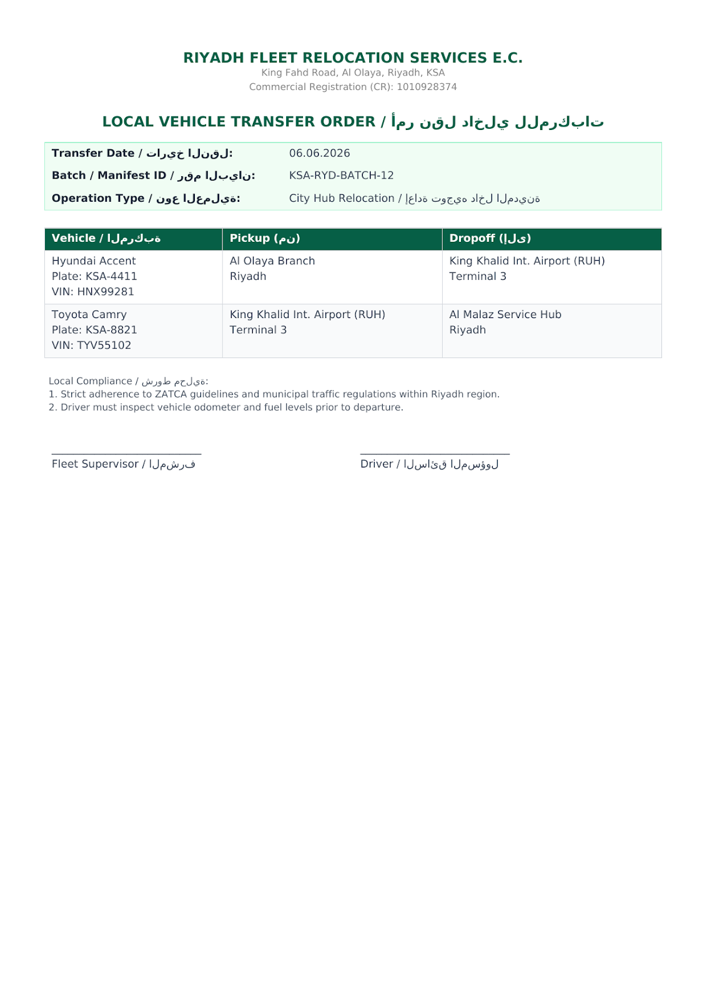

# FleetReloc OSS Preview

Disclaimer: This repository is an independent, personal R&D portfolio project developed strictly on my own time, using my own personal equipment, and without any relation, contribution, or connection to any current or past employers. All concepts, code structures, and architectures presented here are autonomous technical explorations and do not utilize proprietary employer resources or trade secrets.

Public preview of **FleetReloc**: a **messenger-first dispatch system** for vehicle relocation agencies, car rental networks, leasing operators and fleet managers in Europe and the GCC. It automates bulk vehicle relocation, moving cars between branches, service centers and airports across multi-leg routes. Drivers work entirely in a chat app: Telegram today, WhatsApp as the second channel.

> **Status:** pre-launch R&D. The system is built and tested, but not publicly deployed and not yet used by customers.

> **About this repository:** this is a public preview. It contains documentation, a demo video, a synthetic sample manifest, and configuration templates. The application source code is maintained in a private repository.

> **Synthetic data notice:** all data in this repository is synthetic and was generated solely for R&D demonstration. That covers the documentation, sample files, screenshots and the demo video: company names, addresses, commercial registration numbers (CR / HRB), manifests, vehicles, VINs, license plates, phone numbers, driver hashes, and batch, task and other IDs. It does not represent any real company's operations, customers, sites, vehicles or drivers. Real public street and place names appear only as geocodable test locations and imply no business relationship.

---

## What FleetReloc does today

### From manifest to dispatched jobs
- **Multi-format intake.** Dispatchers upload transport manifests as PDF, scanned image, Excel, CSV or JSON. Several files can be uploaded at once, each assigned to its leg.
- **Asynchronous processing.** Scanned documents are processed in the background (`202 Accepted`), so large manifests never hit request timeouts.
- **Human in the loop.** Low-confidence extractions are marked for review. The dispatcher corrects them in the dashboard before any offer reaches a driver, and edits flow through to the dispatched jobs (re-geocoded and re-routed).

### Privacy-first, on-premise parsing
- **OpenCV preprocessing:** grayscale, `fastNlMeansDenoising`, Otsu binarization.
- **Multi-language Tesseract:** `eng+deu+ara`, with fallback.
- **Self-hosted LLM (Ollama, Llama 3):** turns OCR text into structured vehicle and address data. Invalid output is sent back to the model with its validation errors to correct itself.
- **Deterministic safeguards:** validation rules and tiered address fallbacks stop malformed extractions from reaching routing and dispatch.
- Document parsing runs entirely within your own infrastructure; no document leaves the server for parsing.

### Multi-leg relay dispatch
- **One batch per leg**, in sequence. A driver is offered leg 2 and later only after claiming or declining the previous leg.
- **Broadcast waves:** offers go out in waves, round-robin over the vehicles still open.
- **Interactive role choice:** drivers tap **Drive**, **Passenger / Co-driver** or **Reject** on Telegram inline buttons.
- **No double assignment:** each claim is decided by a single conditional PostgreSQL update, with no lock service, so when two drivers tap at once, exactly one gets the car. Verified with concurrent-claim tests.
- **Return-leg (backhaul) matching** within a dispatch session.
- **Safe Telegram retries:** each Telegram update is processed once, so a redelivered message never runs a claim twice.
- **Pluggable channels:** a `DriverNotifier` interface with Telegram and WhatsApp (Bird) implementations.

### Security and data protection
- **Dashboard login:** OpenID Connect via Keycloak (authorization code + PKCE). Every dashboard API call needs a login token, and the tenant comes from the verified token.
- **Zero-PII driver identity:** phone numbers are normalized and turned into irreversible keyed hashes (HMAC-SHA256) at the API boundary. Only the hash and a masked display form are stored. Raw numbers never reach the database, the cache or the logs.
- **Verified driver registration:** a driver links their chat by sharing their *own* Telegram contact. Nothing is inferred.
- **Automatic tenant isolation:** every database query is filtered by tenant (SQLAlchemy event listeners plus request-scoped context), and the database itself rejects links between different tenants' data.
- **Fail-closed webhooks:** Telegram and WhatsApp webhooks reject any call without the shared secret.
- **Hardened by default:**
  - Production refuses to start with placeholder or weak secrets, or without a login method.
  - Phone numbers are kept out of URLs; phone numbers and secrets are redacted from access logs.
  - Error responses never expose internals.
  - Request, upload and spreadsheet size limits, plus a zip-bomb guard.
- **Demo mode:** a configurable demo number (`DEMO_MAGIC_PHONE`) routes messages to a demo chat, for live presentations without real driver data.
- Designed for data minimisation (GDPR, Saudi PDPL); retention and deletion controls are on the roadmap.

### Dispatcher dashboard
- Next.js 16 / TypeScript, in **English, German and Arabic**, with full right-to-left layout.
- Manifest upload, review and editing, per-leg broadcasts, auto-refreshing driver and vehicle status, and route maps.

---

## How it works

1. **Upload:** the dispatcher uploads one or more manifests and assigns legs.
2. **Extract:** structured files are imported directly; scans go through OpenCV, OCR and the local LLM, then geocoding and real-road routing.
3. **Review:** uncertain extractions wait for the dispatcher's approval.
4. **Broadcast:** leg 1 offers go out to drivers in waves over Telegram; single offers can also go through WhatsApp.
5. **Claim:** the first driver to tap gets the vehicle, atomically. Others can join as passengers or pick another vehicle.
6. **Relay:** a driver who finished or declined a leg becomes eligible for the next one, and so on along the chain.

---

## 🗺️ Routing & geolocation
- **Routing:** OSRM for real-road geometry, distances and durations. Mapbox is supported as an alternative, with a straight-line fallback if neither responds.
- **Configuration (.env):**
  ```env
  ROUTING_PROVIDER=osrm
  # Public endpoint for quick evaluation:
  OSRM_BASE_URL=https://router.project-osrm.org/route/v1/driving
  # Or a self-hosted container for isolated environments:
  # OSRM_BASE_URL=http://osrm:5000/route/v1/driving
  ```
- **Data isolation:** for high-compliance deployments, self-host OSRM so fleet coordinates never leave your infrastructure. Self-hosted geocoding is on the roadmap.

---

## Roadmap

Planned, not built yet:
- **Driver messages in German, English and Arabic,** with the language set per driver.
- **Batch result export** (Excel/CSV): who drove which car, on which leg, when.
- **WhatsApp at parity with Telegram:** the same claim, passenger and relay flow, starting with a manual relay mode that needs no WhatsApp API.
- **Production deployment and observability:** reverse proxy with TLS, error tracking, tracing and metrics.
- **Extraction quality benchmark:** labelled EN/DE/AR test documents with per-field accuracy and review-rate tracking.
- **Retention and deletion controls** for driver data.
- **Later:** fully on-premise geo data (self-hosted geocoding), live driver location from Telegram, a route optimization solver (driver-to-leg assignment under time windows), bring-your-own LLM endpoint (any approved OpenAI-compatible model), and high availability.

---

## Demo preview

> The dispatcher dashboard in action: instant language switching (English / RTL Arabic), manifest upload, wave-based driver broadcasts via Telegram, and live status tracking:
## Demo

[](https://www.loom.com/share/81788d87f4f84b9fa9157a6e998a89aa)

*Personal R&D / portfolio project. Synthetic data. Not a commercial product. (~9 min)*

---

## Documentation

- [api_protocols.md](docs/api_protocols.md): authentication, endpoints, webhooks, the parsing pipeline and error conventions, as built.
- [db_schema.md](docs/db_schema.md): PostgreSQL schema, the route-leg state machine, session-based parallel dispatch, and multi-tenant isolation rules.

---

## Sample ingestion document

A synthetic bilingual (English/Arabic) transport manifest (`local_order_ksa.png`), of the kind the OCR and LLM pipeline turns into vehicles (Hyundai, Toyota) and Riyadh-based addresses:



*(Synthetic; see the synthetic data notice above.)*

---

## Tech stack

- **Backend:** Python 3.12, FastAPI, async SQLAlchemy 2.0, Alembic, Pydantic v2, PostgreSQL (JSONB), Redis.
- **Auth:** Keycloak (OpenID Connect, PKCE).
- **AI / parsing (on-premise):** OpenCV, Tesseract (`eng+deu+ara`), Ollama (Llama 3).
- **Messaging:** Telegram Bot API, WhatsApp via Bird.
- **Routing:** OSRM (self-hosted or public), Mapbox (optional), Nominatim geocoding.
- **Frontend:** Next.js 16, React, TypeScript, Tailwind CSS, next-intl (EN/DE/AR, RTL).
- **Infrastructure:** Docker, Docker Compose.
