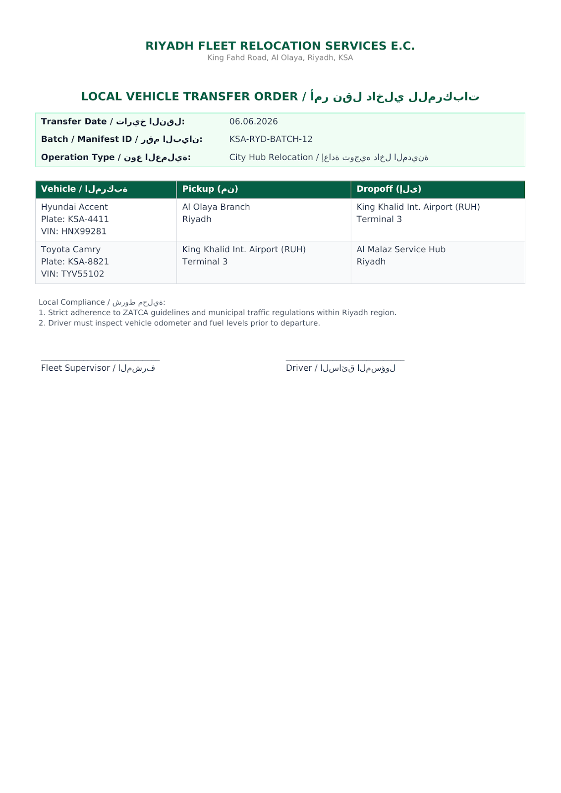

# FleetReloc — public preview

**FleetReloc** is dispatch software for bulk vehicle relocation: moving cars between rental branches, airports, service centres and dealers. Drivers work through a messenger; there is no driver app.

> **Status:** pre-launch R&D. Built and tested, not publicly deployed.

> **About this repository:** a public preview with documentation, a demo video, a synthetic sample manifest and configuration templates. The application source code is in a private repository.

> **Synthetic data notice:** all data in this repository is synthetic and was generated for R&D demonstration only. That includes the documentation, sample files, screenshots and the demo video: company names, addresses, registration numbers, manifests, vehicles, VINs, plates, phone numbers, hashes and IDs. Real street and place names appear only as geocodable test locations.

---

## What it does

1. **Order intake.** The dispatcher uploads orders as PDF, scans, phone photos, Excel, CSV or JSON.
2. **Extraction.** PDFs with a text layer are read directly. Images go through OCR on the server. A local LLM then turns the text into vehicles, plates, VINs and stops.
3. **Review.** A batch goes to the dispatcher for review when the LLM is unsure *or* a check fails: every VIN and plate must appear in the document's own text, nothing may be missing, and instruction-like text in the document ("ignore previous instructions") blocks it. The dispatcher sees why.
4. **Offers.** Offers go out to drivers in waves on Telegram, with **Claim / Passenger / Reject** buttons.
5. **Claim.** The first driver to claim gets the car. Two drivers can never get the same car.
6. **Routes.** Multi-leg routes (relay legs), passenger mode and return-trip matching.

The dispatcher dashboard is in English, German and Arabic (right-to-left).

---

## Key design choices

### On-server OCR, chosen by benchmark
- **Engine:** RapidOCR with PaddleOCR PP-OCRv5 models. The Latin or Arabic model is chosen by the upload's region. It runs on CPU only and needs no network, because the models are part of the Docker image. Tesseract is the fallback.
- **Benchmark (on synthetic test pages):**

  | | Tesseract | RapidOCR |
  |---|---|---|
  | VINs found, low-resolution scan | 6/10 | 10/10 |
  | Plates found, low-resolution scan | 0/10 | 10/10 |
  | Arabic words read | 74–81% | 96–100% |

  *One synthetic page per condition, with 10 VINs and 10 plates; Arabic measured on two synthetic pages of 111 words each.*

- **Rejected options:**
  - Tuned Tesseract.
  - A per-line Latin/Arabic hybrid.
  - EasyOCR.
  - Apple Vision: macOS only.
  - A vision LLM (Qwen2.5-VL): needs a GPU and changed VIN characters.
  - Cloud OCR: documents would leave the customer's servers.

### Local LLM, checked rather than trusted
- A local LLM (Ollama, Llama 3) extracts the structured data. It corrects its own invalid output (up to 3 attempts). Temperature 0 and a fixed seed make the output repeatable.
- Validation repairs VINs: I/O/Q read as 1/0/0, and split VINs are joined. A missing VIN or plate is filled only from the same car's row.
- **Review by checks, not by the model's confidence.** The confidence score is self-reported, and an uploaded document is untrusted input. So deterministic checks also decide review (see step 3), and each reason is stored for the dispatcher.
- **Prompt injection:** the document is passed to the model marked as data, with an instruction never to follow text inside it. That lowers the risk; the checks above are what stop such a batch from reaching drivers unreviewed.
- **Measured:** an offline eval harness runs the full pipeline on 36 synthetic documents (126 cars; English, German and Arabic orders; digital PDFs, scans and photos) and scores each field. Example: carrying order-level dates to every car raised date accuracy from 38% to 67% (English and German: 100%), and cars with every field right from 19% to 33%. Arabic extraction is the weak spot (VINs 29%); every Arabic document still goes to manual review, and the checks catch it.

### One bad file never blocks the rest
- Scanned manifests are parsed by a worker from a job queue in PostgreSQL. Every file is its own job with a time limit: a broken or hanging file fails alone and is reported to the dispatcher, and the other files keep going.
- A crashed worker's jobs are picked up again, and files already read are not read twice.
- A client retrying an upload with the same `Idempotency-Key` gets the first batch back, not a duplicate.

### Atomic claims in the database
- Claiming a vehicle is one conditional database update (`UPDATE … WHERE status='unassigned' RETURNING`), so two drivers can never get the same car.
- This replaced an earlier single-server Redis lock with a 15-minute expiry.

### Privacy and tenant isolation
- **Driver phone numbers:**
  - Turned into a keyed hash (HMAC-SHA256) at the API boundary.
  - Only the hash and a masked form (e.g. `+49•••••0001`) are stored, in PostgreSQL and Redis.
  - Never put in URLs; logs redact them.
- **Login:** OIDC through Keycloak (authorization code + PKCE). The API verifies each token and takes the tenant from it.
- **Tenant isolation:** every query is filtered by tenant automatically, and the database rejects cross-tenant links.
- **Retention:** batches and their files are deleted after a configurable retention period, or by the dispatcher at any time.

### Hardening
- Production refuses weak secrets.
- Webhooks fail closed without their secret.
- Request, upload and spreadsheet size limits.
- Errors never expose internals.
- Outbound messages are metered.

### On-premise option
- `ON_PREMISE_GEO=true` switches to self-hosted routing (OSRM) and geocoding (Nominatim).
- With it set, the app refuses to start if it is configured for public geo services.
- Checked on a network with no route to the internet: addresses were geocoded and routed by the self-hosted services alone.

---

## Tech stack

- **Backend:** FastAPI (Python), async SQLAlchemy, PostgreSQL, Redis, Alembic; a procrastinate job queue in PostgreSQL for scanned manifests.
- **Tests:** pytest on a real PostgreSQL, Playwright end-to-end tests; CI on GitHub Actions.
- **Dashboard:** Next.js 16 (TypeScript); English, German, Arabic (RTL).
- **OCR / extraction:** RapidOCR (PaddleOCR PP-OCRv5), Tesseract fallback, Ollama (Llama 3).
- **Messaging:** Telegram Bot API.
- **Login:** Keycloak (OIDC, PKCE).
- **Geo:** OSRM, Nominatim.
- **Runtime:** Docker, Docker Compose.

---

## Planned

Implemented and tested, waiting for an end-to-end check before they count as built:
- **WhatsApp offers through the dispatcher's own WhatsApp:** ready-made offer texts (English, German, Arabic) with a share link that contains no phone number, and the driver's answer recorded in the dashboard. No WhatsApp API, no phone numbers on the server.
- **Reliable driver messages:** messages are written in the same database transaction as the change they report (transactional outbox) and sent by a relay that retries transient failures; incoming Telegram taps are processed at least once and decided at most once.

Not built yet:
- Retention limits for driver data, and deleting a driver's data on request.
- Vehicle inspection at pickup and drop-off; driver settlement; reports and invoices for the customer ordering the moves.
- Public deployment and monitoring.

---

## Demo

*R&D project, synthetic data. (~9 min)*

---

## Sample order

A synthetic bilingual (English/Arabic) transport order of the kind the intake pipeline reads:

---

## Documentation

- [api_protocols.md](docs/api_protocols.md): authentication, endpoints, webhooks and error conventions.
- [db_schema.md](docs/db_schema.md): PostgreSQL schema, route-leg states and tenant isolation.
